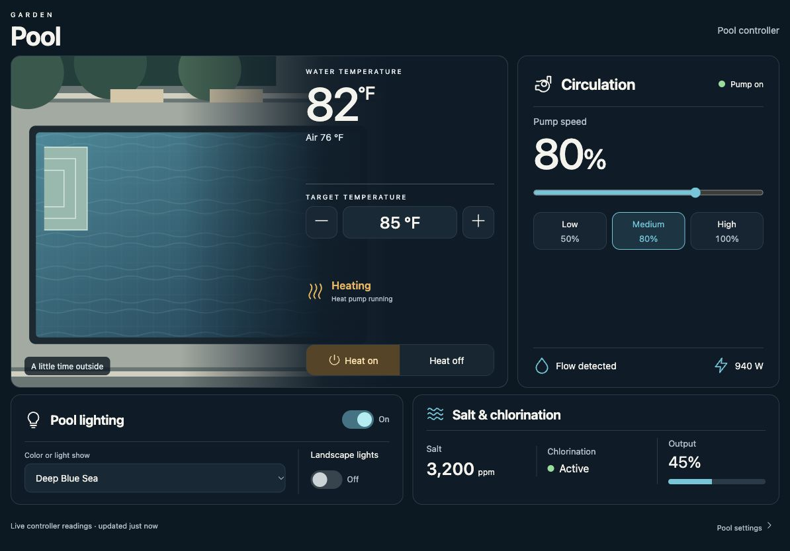

<div align="center">

# Pool Control Card

### Your pool. One clear view.

A photo-led Home Assistant card for pool temperature, circulation, lighting and chlorination — configured through the visual card editor.

[](https://github.com/neilfernandez/pool-control-card/actions/workflows/checks.yml)

[](LICENSE)


</div>

> **Private development preview.** The visual editor is implemented. No public release or HACS listing has been published. HACS installation becomes available after the repository is public and its release is verified.



*Generic illustration and simulated readings. Use your own pool photo and equipment.*

<details>
<summary>Table of contents</summary>

- [Features](#features)
- [Installation](#installation)
- [Visual editor](#visual-editor)
- [Configuration](#configuration)
- [Equipment mappings](#equipment-mappings)
- [Compatibility](#compatibility)
- [Development](#development)
- [License](#license)

</details>

## Features

- **Your own pool photo**, with live readings layered beside it.
- **Visual configuration** with native entity pickers; no YAML required for supported options.
- **Temperature & heating:** water and air readings, heater target and heating state.
- **Circulation:** pump status, speed, presets, water flow and power.
- **Lighting:** pool effects and landscape lighting.
- **Salt & chlorination:** salinity, generation state and output.
- **Only the equipment you use:** unassigned sections hide automatically.
- **Card or full tablet panel**, with optional dashboard navigation.
- **Live state and clear feedback:** confirmations for major equipment changes, unavailable states, service-mode checks and failed-command messages.
- **No runtime dependencies**, external image service or stored credentials. Commands use the existing signed-in Home Assistant client.

## Installation

### HACS — planned

The repository includes its HACS manifest and correctly named JavaScript module. It is **not in the HACS default store yet**, and a private repository cannot be installed through HACS. After public release, installation will initially use **HACS → Custom repositories → Dashboard**. Instructions and a direct HACS link will be added after that flow has been verified.

### Manual installation — development

1. Copy `pool-control-card.js` into Home Assistant's `config/www/` directory.
2. Open **Settings → Dashboards → ⋮ → Resources**. Advanced Mode may need to be enabled in your Home Assistant profile.
3. Add `/local/pool-control-card.js?v=0.2.0` as a **JavaScript module**.
4. Reload Home Assistant in your browser.
5. Open a dashboard, choose **Edit dashboard → Add card**, and search for **Pool Control Card**.
6. Pick your equipment in the visual editor and save.

No pool equipment is selected automatically. You can start with only a water temperature sensor and add controls later.

## Visual editor

Open **Edit dashboard → Edit** on an existing Pool Control Card. The editor provides:

| Section | Settings |
| --- | --- |
| Appearance | Title, area, controller label, photo path and caption, layout, accent |
| Temperature & heating | Water/air sensors, heater and active-heating sensor |
| Circulation | Pump switch, speed number, preset buttons, flow and power |
| Lighting | Pool light and landscape switch |
| Salt & chlorination | Salt sensors, chlorinator switch, generating state, output and alerts |
| Controller safeguards | Service-mode sensor and schedule restoration button |
| Visible sections | Automatic, always show or hide each equipment section |
| Navigation | Add/remove labeled internal dashboard links and icons |

The preview updates as you edit. Configuration changes do not operate equipment. YAML editing remains available, and fields from other groups are preserved when you edit a section.

If you use kiosk mode, exit it before editing. After installing an update, reload the browser and reopen the card editor if the old editor is still shown.

## Configuration

```yaml
type: custom:pool-control-card
title: Pool
layout: card
entities:
  water: sensor.example_pool_water_temperature
  pump: switch.example_pool_pump
```

See [a basic card](examples/basic.yaml) or [a full panel view](examples/panel.yaml).

| Option | Default | Description |
| --- | --- | --- |
| `title` | `Pool` | Main heading |
| `area` | `BACKYARD` | Small label above the heading |
| `controller` | `Pool controller` | Controller label |
| `image` | empty | Optional `/local/` image path |
| `image_caption` | empty | Optional caption over the photo |
| `layout` | `card` | `card` or `panel`; panel is intended for a dashboard panel view |
| `accent` | `aqua` | `aqua`, `blue`, `green`, `amber` |
| `entities` | empty | Equipment entity mapping |
| `sections` | automatic | `temperature`, `circulation`, `lighting`, `quality`: `auto`, `show`, `hide` |
| `navigation` | empty | Up to eight links containing `label`, internal `path`, optional `mdi:` `icon` |

Pool photos are optional and stay in your Home Assistant instance. No personal photograph is bundled. Internal navigation paths must begin with `/` and cannot point to another host.

### Equipment mappings

Every mapping is optional. Entity domains are validated, and a missing/unavailable mapped entity disables its control. Only map entities that actually represent the named pool equipment.

| Key | Domain | Purpose |
| --- | --- | --- |
| `water` / `air` | `sensor` | Water / air temperature |
| `heater` | `water_heater` | Target and on/off operation mode |
| `heating` | `binary_sensor` | Actively heating |
| `pump` | `switch` | Filter pump on/off |
| `speed` | `number` | Pump speed in percent |
| `low` / `medium` / `high` | `button` | Controller speed presets |
| `power` | `sensor` | Pump power |
| `flow` | `binary_sensor` | Flow detected |
| `lights` | `light` | Pool lighting and integration-provided effects |
| `landscape` | `switch` | Landscape lighting |
| `salt` / `instantSalt` | `sensor` | Average / instantaneous salinity |
| `chlorinator` | `switch` | Chlorinator enabled |
| `generating` | `binary_sensor` | Actively generating chlorine |
| `output` | `number` | Chlorinator output percent |
| `fault` / `alert` | `binary_sensor` | Chlorinator fault / alert |
| `serviceMode` | `binary_sensor` | Disable physical controls during service mode |
| `restore` | `button` | Resume controller schedules |

Confirmations cover pump operations, heater changes, light effects, chlorinator settings and schedule restoration. Pool/landscape light on/off toggles are direct controls. Equipment states update from the controller; the card does not assume a command succeeded.

## Compatibility

- **Home Assistant 2026.10 or later** is the current target. Earlier versions are not verified.
- Initial integration target: **OmniLogic Local 2.0.2 / Hayward OmniPL**.
- Other controllers are not yet listed as supported, even if some matching entities work.
- Heater control expects `water_heater.set_operation_mode` with `on` / `off`, plus `set_temperature`.
- Pump speed and chlorinator output expect percentage `number` entities.
- Preset labels use the integration's `speed` attribute when available.
- Active heating uses the selected sensor, with an OmniLogic equipment-state fallback.
- A water temperature unavailable while the pump is off is shown as unavailable, rather than replaced with air temperature.

## Development

The root JavaScript module is both source and installable artifact. No build or package installation is required.

```sh
npm run check
npm test
```

See [Contributing](CONTRIBUTING.md), [Changelog](CHANGELOG.md) and [Roadmap](ROADMAP.md). The tagged release workflow creates a draft release for review; it does not publish or change repository visibility automatically.

The card and editor are original implementations. [Vehicle Status Card](https://github.com/ngocjohn/vehicle-status-card) inspired the approach to visual configuration and project presentation.

## License

[MIT](LICENSE). Home Assistant and HACS are independent projects; this card is a community project.
